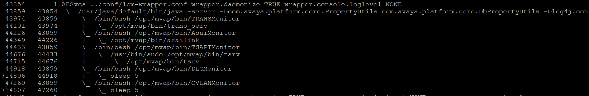
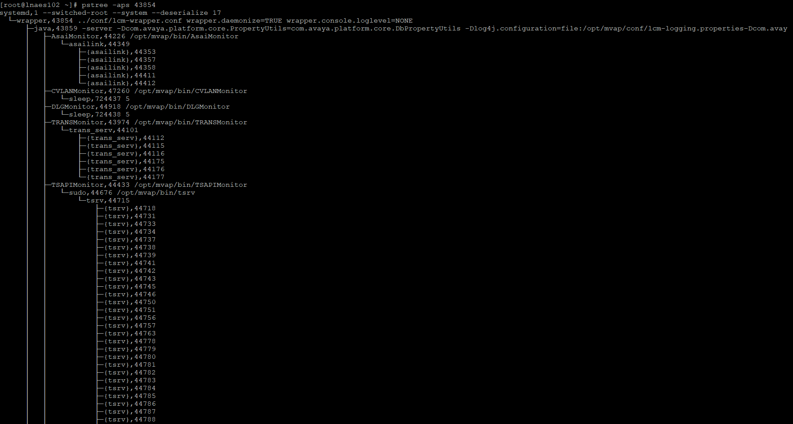
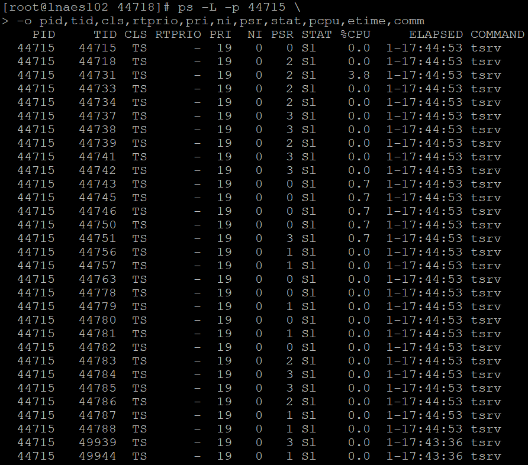

# [Process](https://avaya.atlassian.net/wiki/spaces/DLBBEWIKI/pages/2514649091/1-5+Process)

```c
// https://elixir.bootlin.com/linux/v4.18/source/include/linux/sched.h#L593
struct task_struct {
    /* --- Identification --- */
	pid_t                       pid;            /* Thread ID (Unique in the kernel) */
	pid_t                       tgid;           /* Thread Group ID (What user space sees as "PID") */

    /* --- Family Relationship Pointers --- */
	struct task_struct __rcu    *real_parent;   /* Points to the process that created it */
	struct task_struct __rcu    *parent;        /* Points to the parent that receives signals like SIGCHLD */

	struct list_head            children;       /* Head of the list containing all of this process's children */
	struct list_head            sibling;        /* Node linking this process to its parent's children list */
};
```

## 📌 Key Takeaway
For a normal, un-debugged process, real_parent and parent point to the exact same task_struct. They only diverge when a process is being actively debugged/traced (e.g., using ptrace).

Here is the exact distinction between the two:

| Field	| Definition & Purpose | What happens under ptrace? | What happens when the creator dies? |
| :--- | :--- | :--- | :---|
| real_parent |	Points to the **original, natural creator** of the process (the process that invoked fork() or clone()) | **Unchanged**. It continues to point to the actual creator. | Points to init (PID 1).|
| parent | Points to the **current dynamic parent** who is the recipient of process events, exit status reports (via wait4()), and terminal death notifications (SIGCHLD). | **Changes** to point to the debugger/tracer process.| Points to init (PID 1) |
 .
 
## 🔍 Deep Dive: How and Why They Diverge
To understand why the kernel maintains two separate pointers, consider these two primary scenarios:

1. When a Process is Being Debugged (The ptrace Scenario)
> If you run a program inside a debugger like gdb or trace it with strace:
> 	1. The debugger uses the ptrace() system call to attach to your target process.
> 	2. Behind the scenes, the kernel temporarily reparents the target process.
> 	3. parent is rewritten to point to the debugger process (e.g., gdb). This ensures that when the target process stops, resumes, or terminates, the debugger receives the SIGCHLD signals and can catch the wait4() reports to inspect registers and memory.
> 	4. real_parent remains pointing to the original shell/process that launched it. Once debugging finishes or gdb detaches, the kernel restores parent back to the value of real_parent.

2. When the Parent Dies (Orphan Processes)
> If the process that created the child exits before the child finishes:
>	- The child becomes an orphan.
>	- The kernel steps in to perform a "reparenting" routine.
>	- Both real_parent and parent are updated to point to init (PID 1) (or a designated subreaper process). 
> This ensures that system resources are cleaned up properly when the child eventually exits.

## 💡 Watch out for
getppid() behavior: In user space, when a process calls getppid(), the kernel returns the PID of the real_parent (not parent) 
 . This ensures that even if a program is being traced by a debugger, it still perceives its original parent process and doesn't get confused by the debugger's PID.

The __rcu Annotation: Both pointers are marked with __rcu (Read-Copy-Update) 
 . This is a performance optimization telling you that these pointers are read using RCU locks to prevent kernel overhead/blocking when iterating the process tree.

# AES processes
> AES Process

> AES Process Tree


## Process priority
```
 ps -L -p 44715 \
> -o pid,tid,cls,rtprio,pri,ni,psr,stat,pcpu,etime,comm
```

Important columns:

| Column | Meaning |
| --- | --- |
| CLS |	Scheduling class |
| RTPRIO | Real-time priority |
| PRI | Kernel scheduling priority shown by ps |
| NI | Nice value |
| PSR | Last/current processor ID |
| STAT | Process state |
| %CPU | Recent CPU usage |

Common scheduling classes:
- TS — normal time-sharing scheduler, generally SCHED_OTHER
- FF — SCHED_FIFO
- RR — SCHED_RR
- B — batch scheduling
- IDL — idle scheduling
- DLN — deadline scheduling