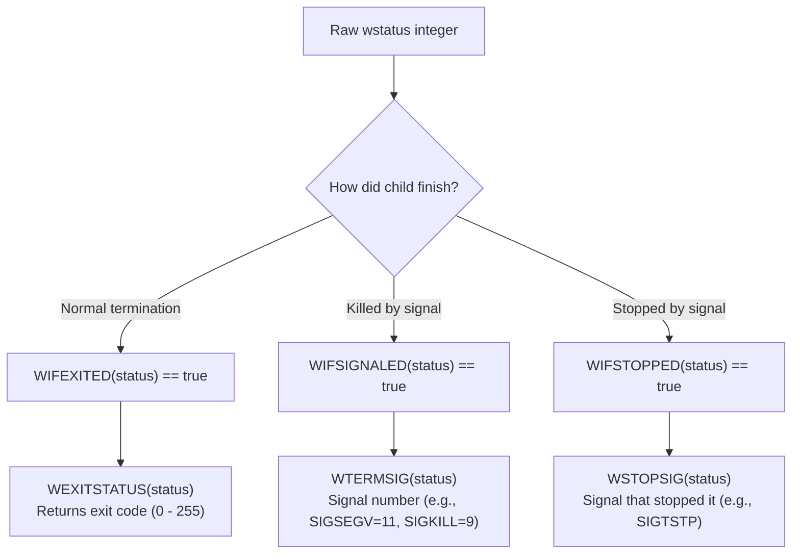

### What is `waitpid()`?

`waitpid()` is a core POSIX system call interface defined in `<sys/wait.h>`. 

Its primary purpose is to allow a **parent process** to:
1. **Monitor state changes** in its child processes (e.g., normal exit, killed by signal, stopped, or resumed).
2. **Retrieve the child's exit status** or termination cause.
3. **Reap "zombie" processes**, allowing the Linux kernel to safely deallocate the child's remaining metadata (`struct task_struct`).

---

### 1. Function Signature

```c
#include <sys/types.h>
#include <sys/wait.h>

pid_t waitpid(pid_t pid, int *wstatus, int options);
```

---

### 2. Parameter 1: `pid_t pid` (Which Child to Target)

`waitpid` gives fine-grained control over which child process to wait for:

| Value of `pid` | Meaning |
| :--- | :--- |
| **`> 0`** | Wait for the **specific child** with process ID equal to `pid`. |
| **`== -1`** | Wait for **any child process** (identical to standard `wait(&status)`). |
| **`== 0`** | Wait for any child process in the **same process group** as the parent. |
| **`< -1`** | Wait for any child process whose process group ID equals `|pid|`. |

---

### 3. Parameter 2: `int *wstatus` (Status Macros)

The kernel packs the child’s exit reason into an integer bitmask pointed to by `wstatus`. You decode it using standard POSIX macros:



#### Example Decoding:
```c
int status;
pid_t reaped_pid = waitpid(child_pid, &status, 0);

if (WIFEXITED(status)) {
    printf("Child exited normally with return code %d\n", WEXITSTATUS(status));
} else if (WIFSIGNALED(status)) {
    printf("Child was killed by signal %d\n", WTERMSIG(status));
}
```

---

### 4. Parameter 3: `int options` (Control Flags)

You can combine flags using bitwise OR (`|`):

| Flag | Description |
| :--- | :--- |
| **`0`** | **Default blocking behavior**: Suspends the parent until the child changes state. |
| **`WNOHANG`** | **Non-blocking polling**: Return immediately without waiting if the child is still running. |
| **`WUNTRACED`** | Also return if a child was **stopped** (e.g., via `Ctrl+Z` / `SIGSTOP`), not just terminated. |
| **`WCONTINUED`** | Also return if a stopped child was **resumed** by receiving `SIGCONT`. |

---

### 5. Return Values

- **`> 0`**: The **PID of the child** whose state changed and was reaped.
- **`0`**: (Only when using **`WNOHANG`**) The child exists and is **still running**.
- **`-1`**: An error occurred. Check `errno`:
  - `ECHILD`: The calling process has no children matching `pid`.
  - `EINTR`: The system call was interrupted by an unblocked signal.

---

### 6. Kernel Mechanics: Preventing Zombie Processes

When a process terminates in Linux:
1. The kernel cleans up its memory address space (`mm_struct`), file descriptors (`files_struct`), etc.
2. However, the kernel **cannot** destroy the process's `struct task_struct` descriptor yet. It enters the **`EXIT_ZOMBIE` (`Z`)** state.
3. The descriptor is preserved so the parent can read its exit code and resource usage statistics (`rusage`).
4. When the parent calls **`waitpid()`**, the kernel runs `do_wait()` (inside `kernel/exit.c`), extracts the status, calls `release_task()`, and finally deallocates the `task_struct` memory from the slab cache.

```text
+----------------+      exit()      +--------------------+     waitpid()     +--------------------+
| Running Child  | ---------------> | Zombie (task_struct| ----------------> | Completely Freed   |
| (Active PID)   |                  | holds exit code)   |                   | (PID reclaimed)    |
+----------------+                  +--------------------+                   +--------------------+
```

> [!IMPORTANT]
> If a parent never calls `wait()` or `waitpid()`, the child remains a **zombie (`<defunct>`)** forever, occupying an entry in the system process table until the parent itself terminates (at which point `init` / `systemd` adopts and reaps the child).