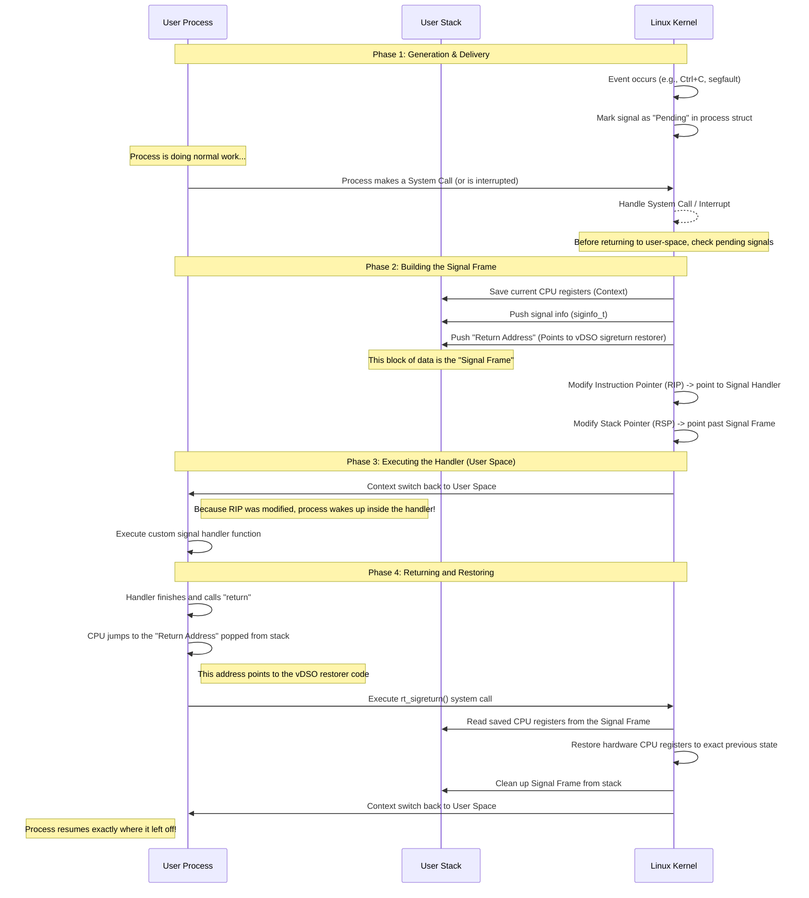

# [Signal](https://avaya.atlassian.net/wiki/spaces/DLBBEWIKI/pages/2578645093/1-6+Signal)

# Decode Signal

use below [script](decode-signals.sh) to decode signals associated with a process
```bash
#!/usr/bin/env bash

pid=${1:?Usage: $0 PID}
status="/proc/$pid/status"

[[ -r "$status" ]] || {
    printf 'Cannot read %s\n' "$status" >&2
    exit 1
}

decode_mask() {
    local hex=$1 digit value bit name
    local sig=1 found=0

    # Start at the rightmost hex digit: its lowest bit is signal 1.
    while [[ -n $hex ]]; do
        digit=${hex: -1}
        hex=${hex%?}
        value=$((16#$digit))

        for bit in 0 1 2 3; do
            if (( value & (1 << bit) )); then
                name=$(builtin kill -l "$sig" 2>/dev/null)
                printf ' %s(%d)' "${name:-UNKNOWN}" "$sig"
                found=1
            fi
            ((sig += 1))
        done
    done

    if (( ! found )); then
        printf ' (none)'
    fi
    printf '\n'
}

while read -r field mask rest; do
    case "$field" in
        SigCgt:|SigIgn:|SigBlk:|SigPnd:|ShdPnd:)
            printf '%-7s %s ->' "$field" "$mask"
            decode_mask "$mask"
            ;;
    esac
done < "$status"
```

## AES TSAPI signal handling
```bash
[root@lnaes102 ~]# ps -ef | grep tsrv
root     2047255 2047137  0 06:14 pts/0    00:00:00 grep --color=auto tsrv
root     3208551 3208440  0 Sep10 ?        00:00:00 /usr/bin/sudo /opt/mvap/bin/                                                                  tsrv
avaya    3208564 3208551  4 Sep10 ?        1-16:12:55 /opt/mvap/bin/tsrv

[root@lnaes102 tmp]# bash decode-signals.sh 3208564
SigPnd: 0000000000000000 -> (none)
ShdPnd: 0000000000000000 -> (none)
SigBlk: 0000000000000000 -> (none)
SigIgn: 0000000000000002 -> SIGINT(2)
SigCgt: 0000000180001804 -> SIGQUIT(3) SIGUSR2(12) SIGPIPE(13) (32) (33)
```

# The Anatomy of a Linux Signal Handler

A signal handler is ultimately **executed in the context of the user process itself, but the entire setup and transition to call it is orchestrated by the kernel.** 

It is a fascinating piece of operating system design because the kernel has to force a user-space process to suddenly jump to a different piece of code (the signal handler), execute it, and then seamlessly resume whatever it was doing beforehand, as if nothing happened.

Here is the detailed step-by-step breakdown of how a signal handler is called in Linux:

### Phase 1: Signal Generation and Delivery (Kernel Side)

1. **Generation:** An event occurs that generates a signal. This could be a hardware exception (like dividing by zero generating `SIGFPE`), a user action (like pressing `Ctrl+C` generating `SIGINT`), or another process sending a signal via the `kill()` system call.
2. **Pending State:** The kernel notes that the signal has been generated for the target process. It updates the target process's internal kernel data structures (specifically, it sets a bit in the process's pending signal mask). The signal is now "pending."
3. **Checking for Pending Signals:** A process doesn't magically stop running code the instant a signal is generated. Instead, the kernel checks for pending signals at very specific, safe transition points. This primarily happens when:
    * The process is returning from kernel space to user space (e.g., a system call like `read()` or `write()` has just finished).
    * The process is returning from handling a hardware interrupt (like a timer interrupt that triggered a context switch).

### Phase 2: Building the Signal Frame (Kernel Side)

Once the kernel decides it is time to deliver the signal (assuming the signal isn't blocked and the process has registered a custom handler for it), it cannot just jump into the handler. Why? Because the process was busy doing something else (e.g., executing a loop). The kernel must save the exact state of the process so it can resume it later.

1. **Saving Context:** The kernel takes all the current CPU registers (the exact state of the program before the signal interrupted it) and pushes them onto the process's **user-space stack**.
2. **Creating the "Signal Frame":** The kernel builds a special data structure on the user stack called a "signal frame" (or `sigframe`). This frame contains:
    * The saved CPU registers (the context to return to).
    * Information about the signal itself (the signal number, and if `SA_SIGINFO` was used, a `siginfo_t` struct with details like who sent it).
    * A "return address" (where the handler should go when it finishes).
3. **Setting up the Restorer (Sigreturn):** The kernel needs a way to regain control after the user-space handler finishes. It sets the "return address" of the signal frame to point to a special piece of code called the "signal restorer." On modern Linux (using vDSO), this restorer is a tiny snippet of code mapped into every process's memory space. This code does exactly one thing: it calls a special system call called `rt_sigreturn()`.
4. **Modifying Registers:** Finally, the kernel intentionally overwrites the process's CPU registers (in the kernel's view of the process). It changes the **Instruction Pointer (RIP/PC)** to point to the memory address of your custom signal handler function. It changes the **Stack Pointer (RSP/SP)** to point just below the newly created signal frame.

### Phase 3: Executing the Handler (User Space)

1. **Transition to User Space:** The kernel completes its work and schedules the process to run in user space again.
2. **The Hijack:** Because the kernel modified the Instruction Pointer in Phase 2, the process wakes up and instantly begins executing the first instruction of your custom signal handler function. 
3. **Handler Execution:** The signal handler runs entirely in user mode. It has normal access to the process's memory (which is why signal handlers must be careful about async-signal-safety—they could interrupt the main program in the middle of updating a shared variable or calling `malloc()`).

### Phase 4: Returning from the Handler (User Space to Kernel to User Space)

1. **The Handler Returns:** When your signal handler reaches its `return` statement (or the end of the function block), it acts like a normal C function returning. It pops the return address off the stack and jumps to it.
2. **Executing the Restorer:** Remember the return address the kernel set up in Phase 2? It points to the vDSO restorer code. The CPU jumps there and executes the `rt_sigreturn()` system call, trapping back into the kernel.
3. **Restoring Context (Kernel Side):** The kernel is back in control. It looks at the signal frame on the user's stack. It takes the saved CPU registers from that frame and restores them to the actual hardware CPU registers.
4. **Resuming Normal Execution:** The kernel schedules the process to run in user space again. Because the Instruction Pointer and Stack Pointer were perfectly restored to their exact values *before* the signal arrived, the process wakes up and continues executing its normal code, completely unaware that it was hijacked to run a signal handler.

### Summary

To answer your question directly: 
* The **kernel** builds the scaffolding (saving state, modifying the stack, changing the instruction pointer).
* The **user process itself** executes the actual code of the signal handler in user-space.
* The **kernel** cleans up afterward (via `sigreturn`) to restore the process to its original state.

The sequence diagram below visualizes this intricate dance between User Space and Kernel Space.



### Key Takeaways

1. **The Kernel does the heavy lifting:** The kernel saves the state, modifies the instruction pointer to force the process to jump to the handler, and sets a trap to regain control later.
2. **The Handler runs in User Space:** The kernel does not execute your handler. It forces your process to execute it in standard user-mode, protecting the kernel from buggy or malicious handler code.
3. **The `sigreturn` magic trick:** A normal C function returns to whoever called it. Because the kernel "called" the handler, it places a fake return address on the stack. When the handler returns, it unwittingly jumps to a tiny piece of code that triggers the `rt_sigreturn()` system call, allowing the kernel to put everything back the way it was.

# Sample Programs

## Program 1 - signal handler
```c
# signalHanlderDemo.c
#include <stdio.h>
#include <stdlib.h>
#include <unistd.h>
#include <signal.h>

void handle_signal(int sig) {
    switch (sig) {
        case SIGINT:
            write(STDOUT_FILENO, "\nCaptured SIGINT (Ctrl+C)\n", 26);
            break;
        case SIGQUIT:
            write(STDOUT_FILENO, "\nCaptured SIGQUIT (Ctrl+\\)\n", 28);
            break;
        case SIGTSTP:
            write(STDOUT_FILENO, "\nCaptured SIGTSTP (Ctrl+Z). Exiting...\n", 39);
            exit(0);
        default:
            break;
    }
}

int main() {
    printf("PID: %d (Ctrl+C: SIGINT, Ctrl+\\: SIGQUIT, Ctrl+Z: Exit)\n", getpid());

    // Configure sigaction struct
    // sa_handler sets the signal disposition:
    // - Custom callback function (e.g., handle_signal)
    // - SIG_IGN (ignore signal)
    // - SIG_DFL (restore default action)
    struct sigaction sa;
    sa.sa_handler = handle_signal;
    sigemptyset(&sa.sa_mask);
    sa.sa_flags = 0;

    // Register signal handlers
    sigaction(SIGINT,  &sa, NULL);
    sigaction(SIGQUIT, &sa, NULL);
    sigaction(SIGTSTP, &sa, NULL);

    while (1) {
        sleep(1);
    }

    return 0;
}
```

```bash
# in one terminal, run the program, and send 2 signals within this terminal. Then capture signals sent from another terminal to the program
[root@DA22053700:LinuxKernel-1-6-Signal]# ./signalHanlderDemo
PID: 59555 (Ctrl+C: SIGINT, Ctrl+\: SIGQUIT, Ctrl+Z: Exit)
^C
Captured SIGINT (Ctrl+C)
^\
Captured SIGQUIT (Ctrl+\)

Captured SIGQUIT (Ctrl+\)

Captured SIGINT (Ctrl+C)

Captured SIGTSTP (Ctrl+Z). Exiting...
```

```bash
#Open another terminal to send signals to the running program
[root@DA22053700:LinuxKernel-1-6-Signal]# kill -3 59555
[root@DA22053700:LinuxKernel-1-6-Signal]# kill -2 59555
[root@DA22053700:LinuxKernel-1-6-Signal]# kill -20 59555
```
## Program 2 - signal handler - when signals are processed
```c
# signalHandlerLifecycle.c
# The program demonstrates how a signal sent from parent process is passed and handled by 
# the child process, even if the child is heavily calculating in USER SPACE

#include <stdio.h>
#include <stdlib.h>
#include <unistd.h>
#include <signal.h>
#include <sys/wait.h>
#include <string.h>
#include <time.h>

volatile sig_atomic_t keep_running = 1;
long long start_time_ms = 0;

// Helper to get monotonic time in milliseconds
long long get_time_ms() {
    struct timespec ts;
    clock_gettime(CLOCK_MONOTONIC, &ts);
    return (long long)ts.tv_sec * 1000 + ts.tv_nsec / 1000000;
}

void handle_signal(int sig, siginfo_t *info, void *ucontext) {
    char msg[512];
    int len;
    long long now_ms = get_time_ms() - start_time_ms;

    if (sig == SIGTERM || sig == SIGINT) {
        len = snprintf(msg, sizeof(msg), 
            "\n--- HANDLER START ---\n"
            "[%lld ms] [Phase 3: User Space] Child caught signal %d. Shutting down...\n"
            "--- HANDLER END ---\n", now_ms, sig);
        write(STDOUT_FILENO, msg, len);
        
        keep_running = 0; 
    } else {
        // Extract the payload sent by the parent via sigqueue()
        int sent_time = info ? info->si_value.sival_int : 0;
        int latency = (int)now_ms - sent_time;
        
        len = snprintf(msg, sizeof(msg), 
            "\n--- HANDLER START ---\n"
            "[%lld ms] [Phase 3: User Space] Child caught signal %d.\n"
            "   -> Sent by PID: %d at %d ms (Latency: %d ms)\n"
            "--- HANDLER END (Phase 4: Returning to calculation) ---\n\n", 
            now_ms, sig, info ? info->si_pid : -1, sent_time, latency);
        write(STDOUT_FILENO, msg, len);
    }
}

void heavy_calculation() {
    long long now = get_time_ms() - start_time_ms;
    printf("[%lld ms] [Child] Starting heavy calculation. CPU is busy...\n", now);
    unsigned long long counter = 0;
    
    while (keep_running) {
        counter++;
        /*if (counter % 300000000ULL == 0) {
            now = get_time_ms() - start_time_ms;
            printf("[%lld ms] [Child] Still calculating... (Iteration %llu)\n", now, counter);
        }
		*/
    }
    
    now = get_time_ms() - start_time_ms;
    printf("[%lld ms] [Child] Heavy calculation stopped gracefully, with counter=%llu.\n", now, counter);
}

int main() {
    start_time_ms = get_time_ms();
    printf("[%lld ms] Starting Interactive Signal Demonstration...\n\n", get_time_ms() - start_time_ms);

    pid_t pid = fork();

    if (pid < 0) {
        perror("Fork failed");
        exit(1);
    }

    if (pid == 0) {
        // ---------------------------------------------------------
        // CHILD PROCESS
        // ---------------------------------------------------------
        long long now = get_time_ms() - start_time_ms;
        printf("[%lld ms] Child  (PID %d): Starting up...\n", now, getpid());

        struct sigaction sa;
        sa.sa_flags = SA_SIGINFO; 
        sa.sa_sigaction = handle_signal; 
        sigemptyset(&sa.sa_mask);

        sigaction(SIGUSR1, &sa, NULL); // Signal 10
        sigaction(SIGUSR2, &sa, NULL); // Signal 12
        sigaction(SIGTERM, &sa, NULL); // Signal 15
        sigaction(SIGINT,  &sa, NULL); // Signal 2

        // Block SIGUSR1 for a few seconds to show delay in processing
        sigset_t block_mask, old_mask;
        sigemptyset(&block_mask);
        sigaddset(&block_mask, SIGUSR1);
        
        now = get_time_ms() - start_time_ms;
        printf("\n[%lld ms] [Child] Briefly blocking SIGUSR1 (10) for 15 seconds during init...\n", now);
        sigprocmask(SIG_BLOCK, &block_mask, &old_mask);
        
        sleep(15);
		
		       
        now = get_time_ms() - start_time_ms;
        printf("[%lld ms] [Child] Init continues. Unblocking SIGUSR1.\n\n", now);
        sigprocmask(SIG_SETMASK, &old_mask, NULL);
		
		
		int count =0;
		do {
			now = get_time_ms() - start_time_ms;
			printf ("\n[%lld ms] [Child] Continuosly being initialied with SIGUSR1 (10) releaed for processing during init...\n", now);
			sleep (5);
			
		} while (count++<4);

        heavy_calculation();
        
        now = get_time_ms() - start_time_ms;
        printf("[%lld ms] Child  (PID %d): Exiting.\n", now, getpid());
        exit(0);

    } else {
        // ---------------------------------------------------------
        // PARENT PROCESS
        // ---------------------------------------------------------
        long long now = get_time_ms() - start_time_ms;
        printf("[%lld ms] Parent (PID %d): Spawned child (PID %d).\n", now, getpid(), pid);
        
        sleep(1); 
        
        int sig_to_send;
        char input[64];

        while (1) {
            now = get_time_ms() - start_time_ms;
            printf("\n[%lld ms] [Parent] Enter a signal number to send (e.g., 10 for SIGUSR1, 15 for TERM, 9 for KILL, 0 to quit): ", now);
            
            if (fgets(input, sizeof(input), stdin) == NULL) {
                now = get_time_ms() - start_time_ms;
                printf("\n[%lld ms] [Parent] Input stream closed (EOF). Sending SIGTERM (15) to clean up...\n", now);
                kill(pid, SIGTERM);
                break;
            }

            sig_to_send = atoi(input);

            if (sig_to_send == 0) {
                now = get_time_ms() - start_time_ms;
                printf("[%lld ms] [Parent] Quitting. Sending SIGTERM (15) to child to clean up...\n", now);
                kill(pid, SIGTERM);
                break;
            }

            long long send_time = get_time_ms() - start_time_ms;
            printf("[%lld ms] [Parent] Sending signal %d to child (PID %d)...\n", send_time, sig_to_send, pid);
            
            // Construct the payload to send WITH the signal
            union sigval sv;
            sv.sival_int = (int)send_time;

            // Use sigqueue() instead of kill() to send the signal + payload
            if (sigqueue(pid, sig_to_send, sv) == -1) {
                perror("[Parent] sigqueue() failed (Did the child already die?)");
                break;
            }
            
            if (sig_to_send == SIGKILL || sig_to_send == SIGTERM || sig_to_send == SIGINT) {
                now = get_time_ms() - start_time_ms;
                printf("[%lld ms] [Parent] Sent a termination signal. Waiting for child...\n", now);
                break;
            }
            
            sleep(5); 
        }

        int status;
        wait(&status); 
        
        now = get_time_ms() - start_time_ms;
        printf("\n");
        if (WIFSIGNALED(status)) {
            printf("[%lld ms] Parent (PID %d): Child was TERMINATED abruptly by signal %d.\n", now, getpid(), WTERMSIG(status));
        } else if (WIFEXITED(status)) {
            printf("[%lld ms] Parent (PID %d): Child exited GRACEFULLY with code %d.\n", now, getpid(), WEXITSTATUS(status));
        }
        
        now = get_time_ms() - start_time_ms;
        printf("[%lld ms] Parent (PID %d): Exiting.\n", now, getpid());
    }

    return 0;
}

```
```bash
[root@DA22053700:LinuxKernel-1-6-Signal]# ./signalHandlerLifecycle
[0 ms] Starting Interactive Signal Demonstration...

[0 ms] Parent (PID 3966): Spawned child (PID 3967).
[0 ms] Child  (PID 3967): Starting up...

[0 ms] [Child] Briefly blocking SIGUSR1 (10) for 15 seconds during init...

[1000 ms] [Parent] Enter a signal number to send (e.g., 10 for SIGUSR1, 15 for TERM, 9 for KILL, 0 to quit): 10
[3309 ms] [Parent] Sending signal 10 to child (PID 3967)...

[8309 ms] [Parent] Enter a signal number to send (e.g., 10 for SIGUSR1, 15 for TERM, 9 for KILL, 0 to quit): 10
[11089 ms] [Parent] Sending signal 10 to child (PID 3967)...
[15000 ms] [Child] Init continues. Unblocking SIGUSR1.


--- HANDLER START ---
[15001 ms] [Phase 3: User Space] Child caught signal 10.
   -> Sent by PID: 3966 at 3309 ms (Latency: 11692 ms)
--- HANDLER END (Phase 4: Returning to calculation) ---


[15001 ms] [Child] Continuosly being initialied with SIGUSR1 (10) releaed for processing during init...

[16089 ms] [Parent] Enter a signal number to send (e.g., 10 for SIGUSR1, 15 for TERM, 9 for KILL, 0 to quit):
[20001 ms] [Child] Continuosly being initialied with SIGUSR1 (10) releaed for processing during init...
10
[22703 ms] [Parent] Sending signal 10 to child (PID 3967)...

--- HANDLER START ---
[22703 ms] [Phase 3: User Space] Child caught signal 10.
   -> Sent by PID: 3966 at 22703 ms (Latency: 0 ms)
--- HANDLER END (Phase 4: Returning to calculation) ---


[22703 ms] [Child] Continuosly being initialied with SIGUSR1 (10) releaed for processing during init...
10
[27703 ms] [Parent] Enter a signal number to send (e.g., 10 for SIGUSR1, 15 for TERM, 9 for KILL, 0 to quit):
[27703 ms] [Child] Continuosly being initialied with SIGUSR1 (10) releaed for processing during init...

[27964 ms] [Parent] Sending signal 10 to child (PID 3967)...

--- HANDLER START ---
[27964 ms] [Phase 3: User Space] Child caught signal 10.
   -> Sent by PID: 3966 at 27964 ms (Latency: 0 ms)
--- HANDLER END (Phase 4: Returning to calculation) ---


[27964 ms] [Child] Continuosly being initialied with SIGUSR1 (10) releaed for processing during init...
10
[32965 ms] [Child] Starting heavy calculation. CPU is busy...

[32965 ms] [Parent] Enter a signal number to send (e.g., 10 for SIGUSR1, 15 for TERM, 9 for KILL, 0 to quit): [32965 ms] [Parent] Sending signal 10 to child (PID 3967)...

--- HANDLER START ---
[32965 ms] [Phase 3: User Space] Child caught signal 10.
   -> Sent by PID: 3966 at 32965 ms (Latency: 0 ms)
--- HANDLER END (Phase 4: Returning to calculation) ---


[37965 ms] [Parent] Enter a signal number to send (e.g., 10 for SIGUSR1, 15 for TERM, 9 for KILL, 0 to quit): 10
[44796 ms] [Parent] Sending signal 10 to child (PID 3967)...

--- HANDLER START ---
[44796 ms] [Phase 3: User Space] Child caught signal 10.
   -> Sent by PID: 3966 at 44796 ms (Latency: 0 ms)
--- HANDLER END (Phase 4: Returning to calculation) ---


[49796 ms] [Parent] Enter a signal number to send (e.g., 10 for SIGUSR1, 15 for TERM, 9 for KILL, 0 to quit): 10
[53958 ms] [Parent] Sending signal 10 to child (PID 3967)...

--- HANDLER START ---
[53959 ms] [Phase 3: User Space] Child caught signal 10.
   -> Sent by PID: 3966 at 53958 ms (Latency: 1 ms)
--- HANDLER END (Phase 4: Returning to calculation) ---


[58959 ms] [Parent] Enter a signal number to send (e.g., 10 for SIGUSR1, 15 for TERM, 9 for KILL, 0 to quit): 20
[60165 ms] [Parent] Sending signal 20 to child (PID 3967)...

[65166 ms] [Parent] Enter a signal number to send (e.g., 10 for SIGUSR1, 15 for TERM, 9 for KILL, 0 to quit): 10
[67433 ms] [Parent] Sending signal 10 to child (PID 3967)...

[72433 ms] [Parent] Enter a signal number to send (e.g., 10 for SIGUSR1, 15 for TERM, 9 for KILL, 0 to quit): 9
[474432 ms] [Parent] Sending signal 9 to child (PID 3967)...
[474432 ms] [Parent] Sent a termination signal. Waiting for child...

[474432 ms] Parent (PID 3966): Child was TERMINATED abruptly by signal 9.
[474432 ms] Parent (PID 3966): Exiting.
```