# [Network](https://avaya.atlassian.net/wiki/spaces/DLBBEWIKI/pages/2702803052/1-7+Network)

# Sockets of Tserver in AES TSAPI service

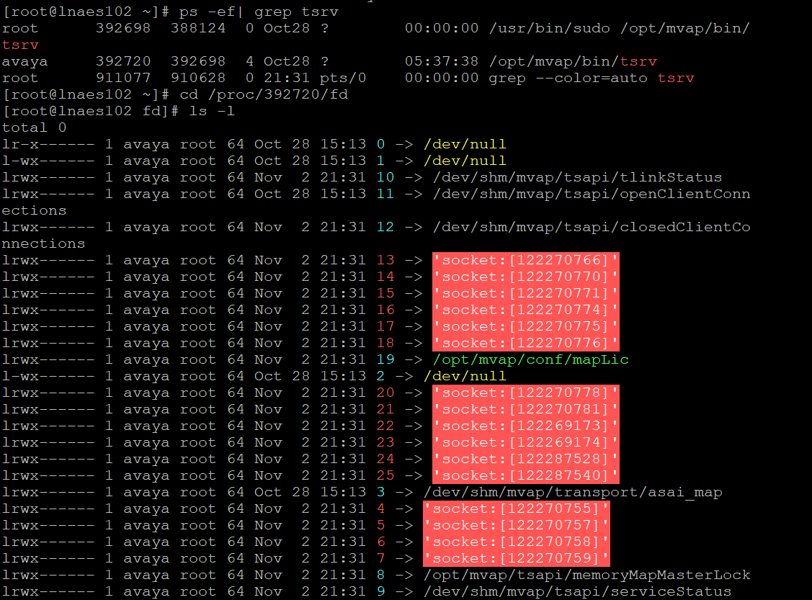

## Details of the tsrv sockets
```
[root@lnaes102 fd]# lsof -Ki -nP -a -c tsrv -d 4-7,13-18,20-25
```
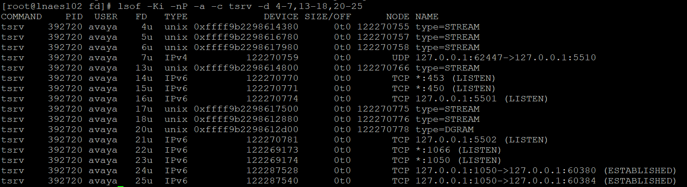

Different [sockets](./sockets.md) are created for different commmunications targetting different destinations
Here is what those columns mean, specifically **`USER`**, **`FD`**, and **`TYPE` (`IPv6`)**:

### Summary of all fields in the line 6, as an example:
| Column | Value | Meaning |
| :--- | :--- | :--- |
| **COMMAND** | `tsrv` | Name of the executable |
| **PID** | `392720` | Process ID |
| **USER** | `avaya` | Linux owner of the process |
| **FD** | `14u` | File Descriptor `14`, opened for read+write (`u`) |
| **TYPE** | `IPv6` | IPv6 socket (`AF_INET6`, which accepts both IPv4 & IPv6 on Linux) |
| **DEVICE** | `122270770` | Kernel socket inode number (matches `socket:[122270770]` in `/proc/392720/fd`) |
| **NODE** | `TCP` | Transport protocol |
| **NAME** | `*:453 (LISTEN)` | Listening on all network interfaces (`*`), port `453` |

A zombie(half closed) socket is found on AES tsrv process as well!

# Sample Programs

## Simple Socket
```
#SimpleSocket.c

#include <stdio.h>
#include <sys/socket.h>
#include <netinet/in.h>

int main() {
    int fd = socket(AF_INET, SOCK_STREAM, 0);
    printf("fd: %d\n", fd);
    while(1);
    return 0;
}
```
```diff
[root@DA22053700:LinuxKernel-1-7-Network]# gcc SimpleSocket.c -o SimpleSocket
[root@DA22053700:LinuxKernel-1-7-Network]# ./SimpleSocket
-fd: 3

[root@DA22053700:LinuxKernel-1-7-Network]# cd /proc/3267/fd
[root@DA22053700:fd]# ls -l
total 0
lrwx------ 1 root root 64 Nov  8 19:39 0 -> /dev/pts/0
lrwx------ 1 root root 64 Nov  8 19:39 1 -> /dev/pts/0
lrwx------ 1 root root 64 Nov  8 19:39 2 -> /dev/pts/0
-lrwx------ 1 root root 64 Nov  8 19:39 3 -> 'socket:[35301]'
```

The socket was just created without being bound to any TCP port, therefore, **netstat** or **ss** won't display the socket since the tcp hash table doesn't have the record for it. We must use lsof command to view its status

```
[root@DA22053700:fd]# lsof -nP -a -p $(pidof SimpleSocket) -d 3
COMMAND    PID USER   FD   TYPE DEVICE SIZE/OFF  NODE NAME
SimpleSoc 3267 root    3u  sock    0,9      0t0 35301 protocol: TCP
```

Here is what each column of that line means for an unbound/unconnected socket:
* **`FD = 3u`:** File descriptor `3`, opened for read/write (`u`).
* **`TYPE = sock`:** Generic socket (not yet `IPv4`, because `bind()` or `connect()` hasn't been called to assign an IP/port and insert it into `/proc/net/tcp`).
* **`DEVICE = 0,9`:** Major/minor device number of the kernel's internal `sockfs` pseudo-filesystem (`mnt_id` for sockets).
* **`NODE = 35301`:** The socket inode number (`socket:[35301]` in `/proc/3267/fd/3`).
* **`NAME = protocol: TCP`:** Confirmed as a `SOCK_STREAM` (TCP) socket, waiting to be bound or connected.

## Client Server communication

* [Server code](https://avaya.atlassian.net/wiki/spaces/DLBBEWIKI/pages/2702803052/1-7+Network#Server-Code-Example)
* [Client code](https://avaya.atlassian.net/wiki/spaces/DLBBEWIKI/pages/2702803052/1-7+Network#Client-Code-Example)

### **Debug server**: 
Before binding, socket status remains as previously shown
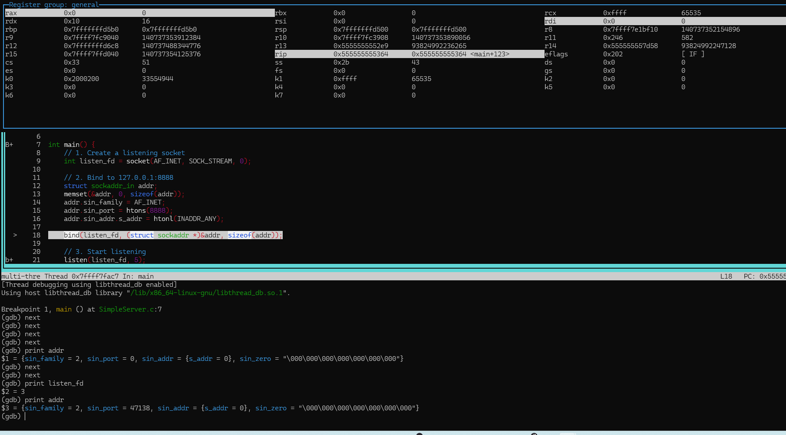

```diff
[root@DA22053700:LinuxKernel-1-7-Network]# cd /proc/24743/fd
[root@DA22053700:fd]# ls -l
total 0
lrwx------ 1 root root 64 Nov  8 23:00 0 -> /dev/pts/0
lrwx------ 1 root root 64 Nov  8 23:00 1 -> /dev/pts/0
lrwx------ 1 root root 64 Nov  8 23:00 2 -> /dev/pts/0
-lrwx------ 1 root root 64 Nov  8 23:00 3 -> 'socket:[351202]'

[root@DA22053700:LinuxKernel-1-7-Network]# lsof -nP -a -p $(pidof SimpleServer) -d 3
COMMAND     PID USER   FD   TYPE DEVICE SIZE/OFF   NODE NAME
-SimpleSer 24743 root    3u  sock    0,9      0t0 351202 protocol: TCP
```

After binding, Socket status changed, 
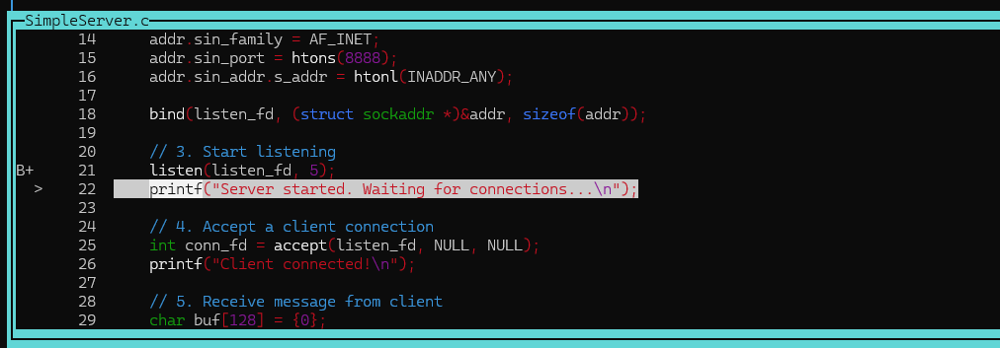
```diff
[root@DA22053700:fd]# lsof -nP -a -p $(pidof SimpleServer) -d 3
COMMAND     PID USER   FD   TYPE DEVICE SIZE/OFF NODE NAME
+SimpleSer 24743 root    3u  IPv4 351202      0t0  TCP *:8888 (LISTEN)


[root@DA22053700:fd]# netstat -tnap | grep 8888
tcp        0      0 0.0.0.0:8888            0.0.0.0:*               LISTEN      24743/SimpleServer
```

After the server accepts connection from the client, status changes to established, with a new FD created
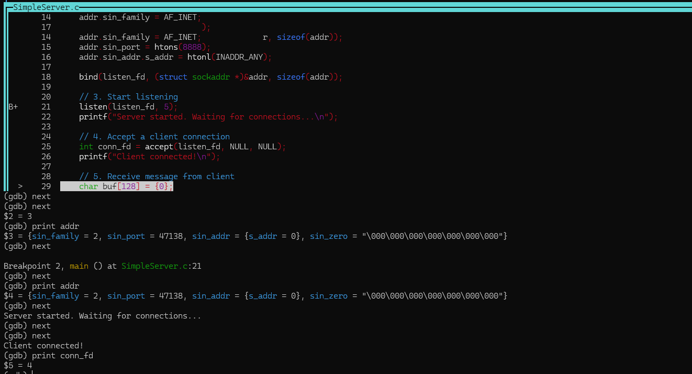
```diff
[root@DA22053700:fd]# ls -l /proc/$(pidof SimpleServer)/fd
total 0
lrwx------ 1 root root 64 Nov  8 23:25 0 -> /dev/pts/0
lrwx------ 1 root root 64 Nov  8 23:25 1 -> /dev/pts/0
lrwx------ 1 root root 64 Nov  8 23:25 2 -> /dev/pts/0
lrwx------ 1 root root 64 Nov  8 23:25 3 -> 'socket:[351202]'
+lrwx------ 1 root root 64 Nov  8 23:25 4 -> 'socket:[413726]'

[root@DA22053700:fd]# lsof -nP -a -p $(pidof SimpleServer) -d 3-4
COMMAND     PID USER   FD   TYPE DEVICE SIZE/OFF NODE NAME
SimpleSer 24743 root    3u  IPv4 351202      0t0  TCP *:8888 (LISTEN)
SimpleSer 24743 root    4u  IPv4 413726      0t0  TCP 127.0.0.1:8888->127.0.0.1:38323 (ESTABLISHED)
```

### **Debug client**: 
Before connect, socket status remains as previously shown
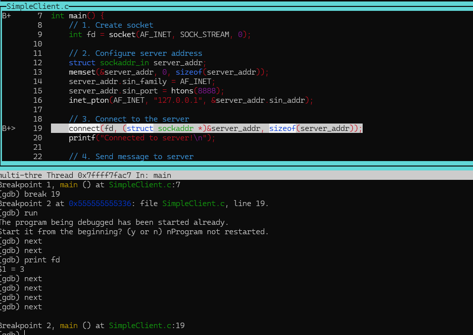
```diff
[root@DA22053700:fd]# cd /proc/$(pidof SimpleClient)/fd
[root@DA22053700:fd]# ls -l
total 0
lrwx------ 1 root root 64 Nov  8 23:08 0 -> /dev/pts/2
lrwx------ 1 root root 64 Nov  8 23:08 1 -> /dev/pts/2
lrwx------ 1 root root 64 Nov  8 23:08 2 -> /dev/pts/2
-lrwx------ 1 root root 64 Nov  8 23:08 3 -> 'socket:[383842]'

[root@DA22053700:fd]# lsof -nP -a -p $(pidof SimpleClient) -d 3
COMMAND     PID USER   FD   TYPE DEVICE SIZE/OFF   NODE NAME
-SimpleCli 24589 root    3u  sock    0,9      0t0 383842 protocol: TCP

[root@DA22053700:fd]# lsof -nP -a -p $(pidof SimpleClient) -d 3
COMMAND     PID USER   FD   TYPE DEVICE SIZE/OFF   NODE NAME
-SimpleCli 24589 root    3u  sock    0,9      0t0 383842 protocol: TCP
```

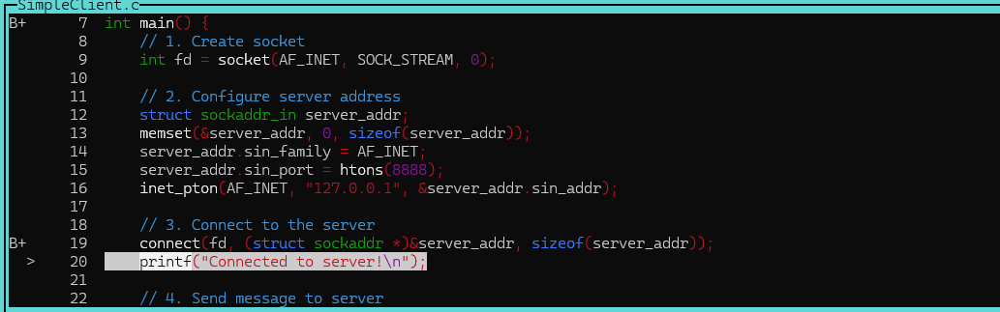
At this stage, the server is **not** ready to accept the connect from the client, the TCP handshake completes but the application is not ready to handle the request, thus the established tcp connection shows no process information, on the server side
```diff
[root@DA22053700:fd]# netstat -tnap | grep 8888
tcp        1      0 0.0.0.0:8888            0.0.0.0:*               LISTEN      24743/SimpleServer
-tcp        0      0 127.0.0.1:8888          127.0.0.1:38323         ESTABLISHED -
tcp        0      0 127.0.0.1:38323         127.0.0.1:8888          ESTABLISHED 24589/SimpleClient
```

After server accepts connection, status changes
```diff
[root@DA22053700:fd]# netstat -tnap | grep 8888
tcp        0      0 0.0.0.0:8888            0.0.0.0:*               LISTEN      24743/SimpleServer
+tcp        0      0 127.0.0.1:8888          127.0.0.1:38323         ESTABLISHED 24743/SimpleServer
tcp        0      0 127.0.0.1:38323         127.0.0.1:8888          ESTABLISHED 24589/SimpleClient


[root@DA22053700:fd]# lsof -nP -a -p $(pidof SimpleClient) -d 3
COMMAND     PID USER   FD   TYPE DEVICE SIZE/OFF NODE NAME
+SimpleCli 24589 root    3u  IPv4 383842      0t0  TCP 127.0.0.1:38323->127.0.0.1:8888 (ESTABLISHED)
```

## Blocked IO server client Communication

### Server
```c
#include <stdio.h>
#include <string.h>
#include <sys/socket.h>
#include <netinet/in.h>
#include <arpa/inet.h>
#include <unistd.h>

int main() {
    // 1. Create a listening socket
    int listen_fd = socket(AF_INET, SOCK_STREAM, 0);

    // Allow immediate restart on port 8888 without waiting for TIME_WAIT
    int opt = 1;
    setsockopt(listen_fd, SOL_SOCKET, SO_REUSEADDR, &opt, sizeof(opt));

    // 2. Bind to 0.0.0.0:8888
    struct sockaddr_in addr;
    memset(&addr, 0, sizeof(addr));
    addr.sin_family = AF_INET;
    addr.sin_port = htons(8888);
    addr.sin_addr.s_addr = htonl(INADDR_ANY);

    bind(listen_fd, (struct sockaddr *)&addr, sizeof(addr));

    // 3. Start listening
    listen(listen_fd, 5);
    printf("Server started on port 8888. Waiting for connections...\n");

    // 4. Loop to handle clients one by one (sequentially / blocking)
    while (1) {
        struct sockaddr_in client_addr;
        socklen_t client_len = sizeof(client_addr);

        printf("\n[Server] Calling accept()...\n");
        int conn_fd = accept(listen_fd, (struct sockaddr *)&client_addr, &client_len);
        int client_port = ntohs(client_addr.sin_port);
        printf("[Server] Accepted client 127.0.0.1:%d (conn_fd=%d)! Waiting for its message...\n",
               client_port, conn_fd);

        // 5. BLOCKS HERE until THIS specific client sends a message!
        char buf[128] = {0};
        recv(conn_fd, buf, sizeof(buf) - 1, 0);
        printf("[Server] Received from 127.0.0.1:%d -> %s\n", client_port, buf);

        // 6. Send a reply back to the client
        char reply[256];
        snprintf(reply, sizeof(reply), "Server received your message: '%s'", buf);
        send(conn_fd, reply, strlen(reply), 0);

        // 7. Close this client's socket before looping back to accept() the next client
        close(conn_fd);
        printf("[Server] Closed connection with 127.0.0.1:%d\n", client_port);
    }

    close(listen_fd);
    return 0;
}

```
 
### Client
```c
#include <stdio.h>
#include <string.h>
#include <sys/socket.h>
#include <arpa/inet.h>
#include <unistd.h>

int main() {
    // 1. Create socket
    int fd = socket(AF_INET, SOCK_STREAM, 0);

    // 2. Configure server address
    struct sockaddr_in server_addr;
    memset(&server_addr, 0, sizeof(server_addr));
    server_addr.sin_family = AF_INET;
    server_addr.sin_port = htons(8888);
    inet_pton(AF_INET, "127.0.0.1", &server_addr.sin_addr);

    // 3. Connect to the server
    connect(fd, (struct sockaddr *)&server_addr, sizeof(server_addr));

    // Print our own local ephemeral port so we can match it on the server
    struct sockaddr_in local_addr;
    socklen_t len = sizeof(local_addr);
    getsockname(fd, (struct sockaddr *)&local_addr, &len);
    printf("Connected to server! (My local client port is %d)\n", ntohs(local_addr.sin_port));

    // 4. Wait for interactive user input before sending
    char msg[128] = {0};
    printf("Type a message to send to server: ");
    fgets(msg, sizeof(msg), stdin);
    msg[strcspn(msg, "\r\n")] = 0; // Remove trailing newline

    send(fd, msg, strlen(msg), 0);
    printf("Sent to server: %s (now waiting for server reply...)\n", msg);

    // 5. Receive reply from server
    char buf[256] = {0};
    recv(fd, buf, sizeof(buf) - 1, 0);
    printf("Received from server: %s\n", buf);

    // 6. Close socket
    close(fd);
    return 0;
}
```

### Test result

1. When multiple clients connected, the server blockes the other clients communication until it handles the message from the socket created for the first client
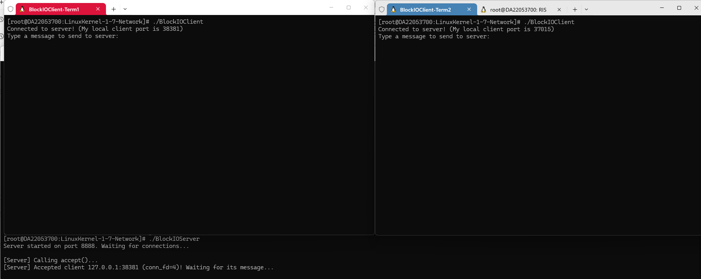
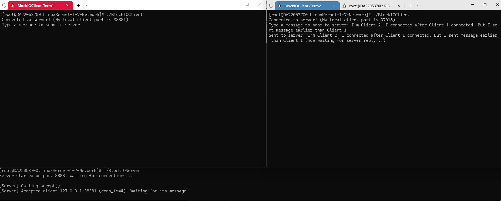
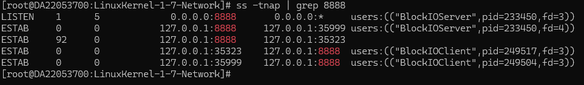
2. Even Client 2 sent message first, its message was only handled after client 1 sent its message


## Multiple Thread server client Communication

### Server
```c
#include <stdio.h>
#include <stdlib.h>
#include <string.h>
#include <sys/socket.h>
#include <netinet/in.h>
#include <arpa/inet.h>
#include <unistd.h>
#include <pthread.h>
#include <sys/syscall.h>

// Struct to pass client info safely to each worker thread
struct client_info {
    int conn_fd;
    int client_port;
};

// Worker thread function: handles ONE client independently
void *handle_client(void *arg) {
    struct client_info *info = (struct client_info *)arg;
    int conn_fd = info->conn_fd;
    int client_port = info->client_port;
    free(info);

    // Get Linux kernel Thread ID (TID) so you can match it in 'lsof' or 'ps -eLf'!
    pid_t tid = syscall(SYS_gettid);
    printf("  [Thread TID=%d] Handling client 127.0.0.1:%d on FD=%d (waiting for message...)\n",
           tid, client_port, conn_fd);

    // Blocks ONLY this worker thread until this client sends a message
    char buf[128] = {0};
    ssize_t n = recv(conn_fd, buf, sizeof(buf) - 1, 0);
    if (n > 0) {
        printf("  [Thread TID=%d] Received from 127.0.0.1:%d -> %s\n", tid, client_port, buf);

        char reply[256];
        snprintf(reply, sizeof(reply), "Handled by Thread TID=%d! Your msg: '%s'", tid, buf);
        send(conn_fd, reply, strlen(reply), 0);
    }

    close(conn_fd);
    printf("  [Thread TID=%d] Closed FD=%d for client 127.0.0.1:%d and exiting thread.\n",
           tid, conn_fd, client_port);
    return NULL;
}

int main() {
    int listen_fd = socket(AF_INET, SOCK_STREAM, 0);

    int opt = 1;
    setsockopt(listen_fd, SOL_SOCKET, SO_REUSEADDR, &opt, sizeof(opt));

    struct sockaddr_in addr = {0};
    addr.sin_family = AF_INET;
    addr.sin_port = htons(8888);
    addr.sin_addr.s_addr = htonl(INADDR_ANY);

    bind(listen_fd, (struct sockaddr *)&addr, sizeof(addr));
    listen(listen_fd, 5);
    printf("[Main PID=%d] Multi-threaded Server listening on 8888 (listen_fd=%d)...\n",
           getpid(), listen_fd);

    while (1) {
        struct sockaddr_in client_addr;
        socklen_t client_len = sizeof(client_addr);

        // Main thread ONLY accepts connections, never blocks on recv()!
        int conn_fd = accept(listen_fd, (struct sockaddr *)&client_addr, &client_len);

        struct client_info *info = malloc(sizeof(struct client_info));
        info->conn_fd = conn_fd;
        info->client_port = ntohs(client_addr.sin_port);

        // Create a detached worker thread for this client
        pthread_t tid;
        pthread_create(&tid, NULL, handle_client, info);
        pthread_detach(tid); // Automatically free thread resources when it finishes
    }

    close(listen_fd);
    return 0;
}
```

### Test result

With a dedicated thread being created on the server once a client connection is accepted, message sent from client 2 is handled immediately even when client 1 doesn't send a message
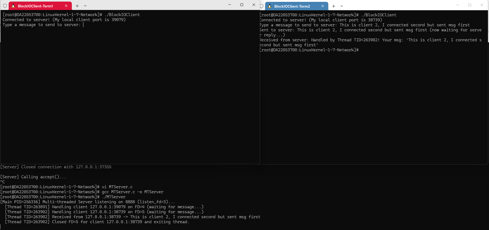
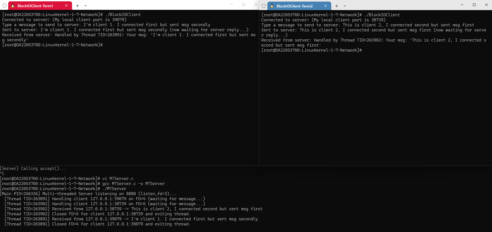

## epoll server
### I/O Multiplexing with epoll (https://avaya.atlassian.net/wiki/spaces/DLBBEWIKI/pages/2702803052/1-7+Network#I%2FO-Multiplexing-with-epoll)
To handle thousands of concurrent client connections efficiently, Linux provides I/O Multiplexing. Instead of using multi-threading or multi-processing (which consumes significant CPU memory), we can use **epoll**.

**epoll** is an event notification mechanism in Linux. It allows a single process to monitor multiple file descriptors to see if any of them are ready for I/O operations (such as reading data or accepting a new connection).


### Test results
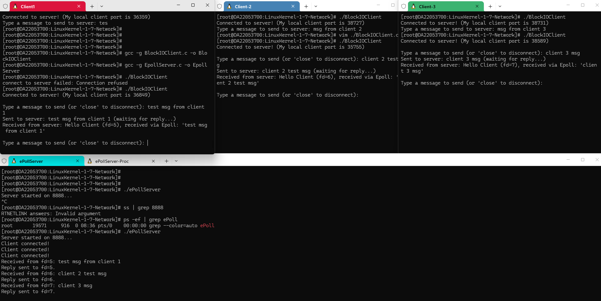
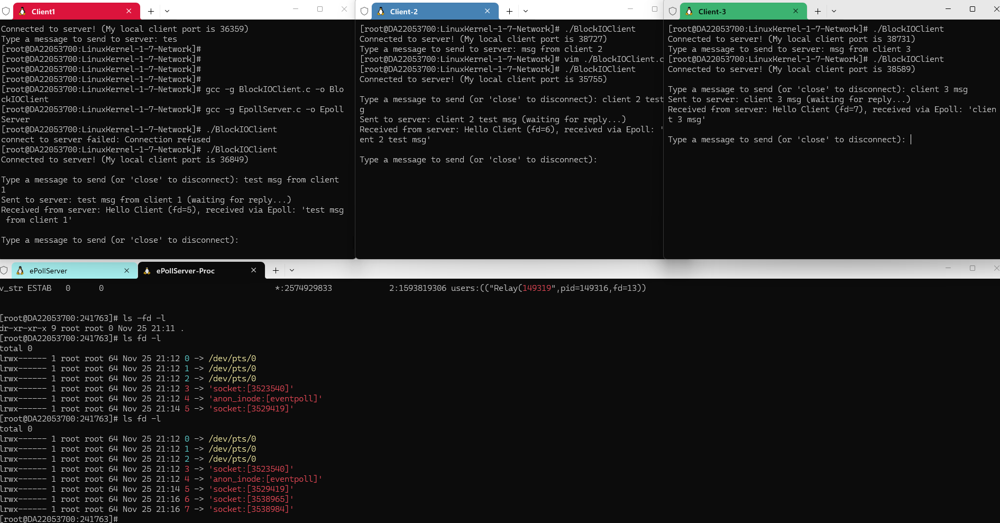

Notice what your /proc/241763/fd output already shows:

- FD **3** (socket:[117506]): Your listening socket (listen_fd on port 8888)
- FD **4** (anon_inode:[eventpoll]): Your epoll_fd watchboard!
- FDs **5, 6, 7**: **3** connected clients (conn_fds) all open at the exact same time!

#### Only one thread!
```bash
[root@DA22053700:fd]# ls -l /proc/241763/task
total 0
dr-xr-xr-x 7 root root 0 Nov 25 21:28 241763

[root@DA22053700:241763]# ps -Lf -p 241763
UID          PID    PPID     LWP  C NLWP STIME TTY          TIME CMD
root      241763     916  241763  0    1 21:11 pts/0    00:00:00 ./ePollServer


[root@DA22053700:241763]# cat /proc/241763/fdinfo/4
pos:    0
flags:  02
mnt_id: 17
ino:    1049
tfd:        5 events:       19 data:                5  pos:0 ino:35dacb sdev:9
tfd:        7 events:       19 data:                7  pos:0 ino:360028 sdev:9
tfd:        6 events:       19 data:                6  pos:0 ino:360015 sdev:9
tfd:        3 events:       19 data:                3  pos:0 ino:35c3d4 sdev:9
```

That single epoll instance (FD 4) in your 1 thread is simultaneously monitoring tfd: 3, tfd: 5, tfd: 6, and tfd: 7!
